# 业务与运维问题演示导览（知识地图）

这份文档给现场演示和方案评审用：当你需要在三副本实验台上向开发、SRE 或数据使用方演示「生产上的重复行、错数、报表漂移、高频小批写入和运维故障是怎么发生的，又该怎么用 ClickHouse 的机制正确解决」时，按这里的四条主线挑脚本跑。

- 标注约定同 [docs/README.md](README.md#标注约定)（`已核` / `lab 实测` / `生产事实` / `推断` / `待一手观察`）。
- 症状到机制的速查表见 [mechanism-map.md](mechanism-map.md)；全部 27 个实验的通过汇总见 [Test-Report.md](Test-Report.md)。这里不重复那两张大表，只按「问题 → 反模式演示 → 正确方案演示」串成可执行的链路。

---

## 一、四条核心问题主线与现场演示顺序

```mermaid
flowchart TD
    subgraph L1["主线一：接入幂等与高频小批写入"]
        P1["Keeper 抖动 + 30s 超时晚到提交<br/>高频小批冲垮 1000 块窗口"] --> Anti1["反模式：开 sink exactlyOnce（实验 21/23）<br/>或只开 async_insert=1 漏开 deduplicate（实验 29 一）"]
        Anti1 --> Sol1["正确方案：服务端异步插入三件套（实验 29 二/三）<br/>+ ReplacingMergeTree 与在线换引擎（实验 14/27）"]
    end

    subgraph L2["主线二：历史脏数据安全清理"]
        P2["历史日分区已落入重复行或错值<br/>且老分区偶有迟到补发"] --> Anti2["反模式：全表轻量 DELETE 读放大（实验 18）<br/>手写列序、无快照、单副本核对（实验 16/17）"]
        Anti2 --> Sol2["正确方案：R0–R8 换分区 Runbook（实验 19/20）<br/>硬链接快照 + insert_quorum=3 + alter_sync=2 + 全副本闸"]
    end

    subgraph L3["主线三：下游聚合与报表一致性"]
        P3["明细有重投或修数后<br/>下游聚合表不会自动回退"] --> Anti3["反模式：默认 MV 去重关闭（实验 24）<br/>时区截断错位、ANY JOIN 静默放大（实验 10）"]
        Anti3 --> Sol3["正确方案：按天对账 + 限线程（实验 26）<br/>+ 从明细 FINAL 带闸重算 REPLACE PARTITION（实验 25）"]
    end

    subgraph L4["主线四：日常运维与高危故障"]
        P4["误删表/分区、Too many parts、<br/>ZooKeeper 顺序号耗尽、生产约束核对"] --> Sol4["正确方案：UNDROP / FREEZE 恢复（实验 07/13）<br/>新路径 ATTACH + EXCHANGE 救序号耗尽（实验 28）<br/>三档生产参数与只读约束核对（prod-check.sh）"]
    end
```



---

### 主线一：重复行是怎么进来的，为什么小批直写和 `exactlyOnce` 都兜不住（实验 12 → 21 → 02 → 23 → 29 → 14 → 27）

**要讲清的机制（lab 实测）：**

1. **重复的起点是「服务端晚到提交」，不是写失败**（[实验 12](../experiments/12-keeper-failure-modes.sh)、[实验 21](../experiments/21-kafka-connect-dedup-and-dlq.sh)）：
   - Keeper 冻住时，HTTP 客户端在第 30 秒超时断开，但客户端断开不会取消服务端在途的 `INSERT`（默认重试退避最长约 142.7 秒）。Keeper 恢复后第一份数据落盘，而 Kafka Connect 在下一个 offset 提交点（30–90 秒后）把同一批原样重投，带同一个 `insert_deduplication_token`。
2. **为什么 1000 块的默认去重窗口拦不住高频小批**（[实验 01](../experiments/01-dedup-defaults.sh)、[实验 02](../experiments/02-dedup-window-overflow.sh)、[实验 03](../experiments/03-part-log-and-dedup.sh)）：
   - 每个 `INSERT` 占一个块槽位；B 档生产每秒约 124–134 次小 `INSERT`，1000 个槽位约 8 秒就满，加上 `ReplicatedMergeTreeCleanupThread` 30–40 秒的裁剪周期（[偏差 A](../README.md#a-blocks-的裁剪是周期性的自适应的不是插到第-window1-个块就立刻顶掉)），超过 40 秒的重投落地成第二份。
   - 被窗口拦下的重投在 `system.part_log` 里同样记 `NewPart`，但 `error = 389`（`INSERT_WAS_DEDUPLICATED`）。
3. **为什么不靠 sink 的 `exactlyOnce`**（[实验 21](../experiments/21-kafka-connect-dedup-and-dlq.sh)、[实验 23](../experiments/23-exactly-once-state-mismatch.sh)）：
   - 同一批超时重投时状态停在 `BEFORE_PROCESSING`，源码直接再写一遍交给 ClickHouse 块级去重，窗口满了一样写出第二份；
   - 打开 `exactlyOnce` 后，worker 崩溃重启重读的批次落在状态表记录区间之前时直接停在 `State MISMATCH`；若写半截批次边界又变了，配 `errors.tolerance=all` 不配 DLQ 会静默丢数据。
4. **入口减压与服务端异步插入的正确开法**（[实验 29](../experiments/29-async-insert-dedup-token.sh)）：
   - **陷阱（实验 29 一）**：25.3 的 `async_insert_deduplicate` 默认 `0`。若只开 `async_insert = 1` 不开 `async_insert_deduplicate = 1`，同一个刷新桶只保留第 1 条子插入的 token 写进 `blocks/`，第 2..N 条子插入的 token 被丢弃（重投漏拦）；更危险的是，一旦重投的 token 恰好第 1 个进桶，同批搭车的全新子插入会被整批判为已去重（HTTP 200）而**静默吞掉**。
   - **正确开法（实验 29 二、三、四）**：必须同时开齐 `async_insert = 1, wait_for_async_insert = 1, async_insert_deduplicate = 1`，且由客户端经 HTTP 参数传 `?insert_deduplication_token=<tok>`（`clickhouse-kafka-connect` 默认就是这种传法；若把 `SETTINGS insert_deduplication_token = …` 写进 SQL 文本内部则会按 AST 拆桶、攒批失效）。开齐后：
     - 20 条并发小插入合成 1 个 `NewPart`、只占 1 条复制日志；
     - 20 个 token 各自写进 `async_blocks/<partition>_<token>`（默认窗口 `replicated_deduplication_window_for_async_inserts = 10000`，是同步窗口的 10 倍）；
     - 混合批次中只剔除重复的旧 token，新 token 正常落盘；坏子插入报 `Code: 27` 并单条回滚，不影响同批好数据。
   - **切换边界（实验 29 五）**：同步写 `blocks/`、异步写 `async_blocks/`，两边互不查对方；通过 `ALTER USER` 切换开关应选在无重投积压的平稳期。
5. **存储层兜底：在线换 `ReplicatedReplacingMergeTree` + `FINAL`**（[实验 14](../experiments/14-replacing-mergetree-final-cost.sh)、[实验 27](../experiments/27-engine-migration-runbook.sh)）：
   - 块级去重只防短时间内的原样重投；跨窗口重放和上游自身重复只能靠 `ReplacingMergeTree` + `FINAL` 按业务键折叠。
   - 实验 14 量出 `FINAL` 比手写 `GROUP BY` 省一个数量级以上的内存；实验 27 演示在 `Replicated` 库里用 `ATTACH PARTITION FROM` + 停写补齐 + 行数闸 + `EXCHANGE TABLES` 在线换引擎并支持回滚。

**现场演示命令：**

```bash
./cluster.sh up all
bash experiments/21-kafka-connect-dedup-and-dlq.sh   # 端到端重现超时重投，以及 exactlyOnce 拦不住同批重投
bash experiments/23-exactly-once-state-mismatch.sh   # 演示 exactlyOnce 重启卡 State MISMATCH 与静默丢数分支
bash experiments/29-async-insert-dedup-token.sh      # 演示服务端异步插入 + token 去重、漏开开关吞新数的陷阱与 20 合 1 攒批
bash experiments/14-replacing-mergetree-final-cost.sh # 对比 FINAL 与手写 GROUP BY 的内存和耗时
bash experiments/27-engine-migration-runbook.sh      # 在线无损换引擎到 ReplicatedReplacingMergeTree
```

---

### 主线二：历史分区的重复行与错数怎么安全清理（实验 08 → 18 → 16 → 17 → 19 → 20）

**要讲清的机制（lab 实测）：**

1. **不同修数手法的物理代价与适用边界**（[实验 08](../experiments/08-mutation-column-rewrite.sh)、[实验 18](../experiments/18-dedup-lightweight-delete.sh)、[review-dedup-replace-plan.md](review-dedup-replace-plan.md#其他清理办法对比)）：
   - `ALTER TABLE … UPDATE / DELETE`：Wide part 下只重写被改的列文件，其余列硬链接复用（实验 08）；Compact part 下重写整个 `data.bin`。
   - 轻量 `DELETE FROM … WHERE …`：只写 `_row_exists` 掩码，但在 25.3 上**必须带 `IN PARTITION ID '<分区>'`**——不带时会触发全表所有分区每个 part 执行子查询并各克隆一版硬链接新 part（实验 18：123 个 part 读窗口 68 遍）。而且当重复组的两行连 `create_time` 都相同时，按列条件删会把两份一起删光。
2. **为什么没加闸的 `REPLACE PARTITION` 脚本在三副本随机路由下会静默丢数**（[实验 16](../experiments/16-dedup-sql-bugs.sh)、[实验 17](../experiments/17-dedup-swap-race-and-replicas.sh)）：
   - SQL 坑（实验 16）：`CREATE TABLE … LIKE` 语法错误；`min(create_time) AS create_time` 别名遮蔽列名触发 `Code: 184`；`INSERT … SELECT` 按位置对列，列序一错整个窗口写串而行数校验全绿；`cityHash64` 遇 `NULL` 整行变 `NULL`。
   - 多副本与时机坑（实验 17 A–D）：
     - **A（并发补发被抹）**：建完临时表到换分区之间写进同一天的 50 行被静默覆盖；
     - **B（连到落后副本建临时表）**：少 1 个 part 的副本建出临时表再换分区，三个副本一起丢掉那 30 行；
     - **C（单节点核对假绿）**：`alter_sync` 默认 `1` 只等发起节点，落后节点还能读到重复行；
     - **D（换分区落到没拉完临时表的副本，三副本清空）**：`INSERT INTO tmp` 默认 `insert_quorum = 0` 只写 1 个副本即返回；若紧接着的 `REPLACE PARTITION` 被负载均衡路由到还没拉到 `tmp` 分区的 `ch3`，**三个副本上的当天分区一起变成 0 行**。
3. **带闸的 `R0–R8` 标准换分区 Runbook 与零拷贝验证**（[实验 19](../experiments/19-dedup-replace-runbook-revised.sh)、[实验 20](../experiments/20-hardlink-zero-copy-proof.sh)）：
   - `R1` 快照（`ATTACH PARTITION … FROM`）、`R5` 换分区、`R7` 回滚在本地盘上全部走硬链接（inode 相同、`written_rows = 0`，实验 20）；
   - 工作表写入加 `SETTINGS insert_quorum = 3`，分区挂载与替换加 `SETTINGS alter_sync = 2`；
   - `R4` 换分区前一刻用 `clusterAllReplicas` 同时核对原表、`dedup`、`bak` 在三个副本上的行数，并按当天分区过滤 `replication_queue`（排除后台 `MERGE_PARTS` / `MUTATE_PART`）；`R6` 用 `part_log` 检查 `[快照时刻, 换分区时刻)` 内是否有 `error = 0` 的 `NewPart` 被覆盖（实验 19）。

**现场演示命令：**

```bash
./cluster.sh up
bash experiments/16-dedup-sql-bugs.sh                # 演示原方案的 4 类 SQL 陷阱（含列序错位静默坏数）
bash experiments/17-dedup-swap-race-and-replicas.sh  # 演示多副本随机落点下的 4 种丢数/假绿（含 D 段三副本清空）
bash experiments/18-dedup-lightweight-delete.sh      # 演示不带 IN PARTITION 的全表 part 放大与 IN PARTITION 修正
bash experiments/19-dedup-replace-runbook-revised.sh # 完整演练 R0–R8 带闸换分区、故障拦截与一键回滚
bash experiments/20-hardlink-zero-copy-proof.sh      # 进容器核验 inode 与硬链接计数，证明快照与换分区零拷贝
```

---

### 主线三：下游聚合与多时区报表怎么防多算、怎么重算（实验 10 → 24 → 25 → 26）

**要讲清的机制（lab 实测）：**

1. **三种不报错的查询口径偏差**（[实验 10](../experiments/10-silent-wrong-queries.sh)）：
   - 分区表达式不显式声明时区时按服务端时区截断；`uniq` 是近似值（精确对账要用 `uniqExact`）；`ANY JOIN` 在右表键不唯一时静默丢弃或翻转行。
2. **物化视图（MV）什么时候会多算**（[实验 24](../experiments/24-mv-dedup-and-refresh.sh)）：
   - 若聚合由 ClickHouse 物化视图驱动：`deduplicate_blocks_in_dependent_materialized_views` 默认 `0`，源表拦下的块（`error = 389`）物化视图照样再算一次；设成 `1` 后还要把 MV 目标表的 `replicated_deduplication_window` 调到不小于源表，且不能和 `async_insert` 同时开（报 `Code: 344`）。
   - 无论聚合是物化视图还是外部定时 `INSERT … SELECT` 作业，窗口外的重复、或者明细表事后用 `DELETE` / `REPLACE PARTITION` 修过数，聚合表都不会自动退回。
3. **按天对账、限流与带闸重算**（[实验 25](../experiments/25-report-reconcile-and-recompute.sh)、[实验 26](../experiments/26-query-isolation-threads.sh)）：
   - 按天对账找出漂移的日期 → 从明细 `FINAL`（或去重后的快照）重算那一天进 staging 表（带 `SETTINGS max_threads = 2`，实验 26 验证对同节点小批写入 p95 影响最小）→ 走行数与迟到写入闸 → `REPLACE PARTITION` 换进聚合表。
   - 多时区日报：用 UTC 30 分钟桶满足整点与半点时区（含夏令时切换日）精确上卷；`:45` 偏移时区需 15 分钟桶（实验 25）。

**现场演示命令：**

```bash
./cluster.sh up
bash experiments/10-silent-wrong-queries.sh          # 演示时区截断、uniq 误差与 ANY JOIN 放大
bash experiments/24-mv-dedup-and-refresh.sh          # 演示物化视图跟随去重的条件与边界
bash experiments/25-report-reconcile-and-recompute.sh # 演示报表漂移检测、带闸重算与多时区上卷
bash experiments/26-query-isolation-threads.sh       # 演示重算限 max_threads = 2 对写入延迟的保护
```

---

### 主线四：日常运维、生产约束核对与高危故障恢复（`prod-check.sh`、实验 07 → 13 → 11 → 28）

**要讲清的机制（lab 实测）：**

1. **生产三档配置与只读约束核对**（[`prod-check.sh`](../prod-check.sh)、[aiven-production-specs.md](aiven-production-specs.md)）：
   - `./cluster.sh up prod`（支持 `TIER=A|B|C`）挂载脱敏后的三档服务端设置与 `default` profile 强约束（如 `max_memory_usage = 10G` 且 `readonly` 不可由客户端上调，`database_atomic_delay_before_drop_table_sec = 0` 等），`bash prod-check.sh` 逐项断言。
2. **误删之后什么能救、什么不能救**（[实验 07](../experiments/07-drop-sync-and-keeper.sh)、[实验 13](../experiments/13-accidental-delete-recovery.sh)）：
   - `DETACH PARTITION` 可直接 `ATTACH` 恢复；
   - `DROP TABLE` 不带 `SYNC` 且 `database_atomic_delay_before_drop_table_sec > 0`（上游默认 480 秒）时可在宽限期内 `UNDROP TABLE`；若该参数被配成 `0` 或执行了 `DROP … SYNC`，当场物理删除；
   - `DROP PARTITION` 没有 `UNDROP`，只能提前 `ALTER TABLE … FREEZE PARTITION` 打硬链接备份，出事后从 `shadow/` 拷回 `detached/` 再 `ATTACH`。
3. **小批高频写入的两种终局故障**：
   - 单分区 active part 累积过快：到 `parts_to_delay_insert`（1000）开始人为拖慢插入，到 `parts_to_throw_insert`（3000）抛 `Too many parts`（[实验 11](../experiments/11-parts-pressure-and-splitting.sh)）。
   - 协调服务是 Apache ZooKeeper 时，复制日志 `log/` 父节点的有符号 32 位顺序计数器（每次 INSERT 每个分区一个 part + 每次 merge 各占 1 个）达到 `2147483647` 后，该表所有 `INSERT` 报 `Code: 244 … Node exists, path …/log/log-`，后台 merge 报 `KEEPER_EXCEPTION`，重启副本无效；只能建新表（换新的 Keeper 路径）+ `ATTACH PARTITION FROM` + `EXCHANGE TABLES` 在线恢复（[实验 28](../experiments/28-zk-sequential-overflow.sh)，需 `./cluster.sh up zk`）。

**现场演示命令：**

```bash
# 1. 演示生产参数与只读约束
TIER=B ./cluster.sh up prod
bash prod-check.sh

# 2. 切回默认设置跑故障恢复与压测演练（prod 模式下 drop 延迟为 0，实验 07/13 需默认 480s）
./cluster.sh up zk
bash experiments/07-drop-sync-and-keeper.sh          # 演示 DROP 不加 SYNC 的 Keeper 副本残留与建表撞车
bash experiments/13-accidental-delete-recovery.sh    # 演示 DETACH、UNDROP、FREEZE 备份恢复与大小护栏
bash experiments/11-parts-pressure-and-splitting.sh  # 演示 Too many parts 阶梯降速与报错
bash experiments/28-zk-sequential-overflow.sh        # 演示 ZooKeeper 2^31-1 顺序号溢出与在线恢复
```

---

## 二、按受众裁剪的演示清单

| 受众 | 建议时长 | 推荐跑的脚本 | 重点传递的结论 |
|---|---|---|---|
| **业务与数据开发** | 25 分钟 | `10` → `16` → `18` → `29` → `14` | 1. 查重一律用 `uniqExact`、分区条件显式带时区、修数 `DELETE` 必带 `IN PARTITION ID`；<br/>2. 避免手写 `argMin` 位置对列，改用 `SELECT * … ORDER BY create_time LIMIT 1 BY 键` 或 `ReplacingMergeTree` + `FINAL`；<br/>3. 异步插入配 token 必须同时开 `async_insert_deduplicate = 1` 且不要把 token 写进 SQL 文本内部。 |
| **SRE 与值班运维** | 30 分钟 | `prod-check` → `12` → `17` → `19` → `13` → `28` | 1. 多副本随机路由下，`system.parts` / `replication_queue` 必须用 `clusterAllReplicas` 全副本查；<br/>2. `REPLACE PARTITION` 必走 `R0–R8`（带 `insert_quorum = 3`、`alter_sync = 2` 和三表全副本行数闸）；<br/>3. 管好 `log_max_index`、Keeper 延迟与 `DROP` 延迟保护，高危操作前先 `FREEZE PARTITION`。 |
| **架构与技术评审** | 30 分钟 | `21` → `23` → `29` → `27` → `25` | 1. 为什么放弃 Kafka Connect 的 `exactlyOnce`，改为「服务端异步攒批 + `async_blocks/` 去重 + `ReplacingMergeTree` 按键折叠」；<br/>2. 存量宽表如何通过 `ATTACH PARTITION` + `EXCHANGE TABLES` 在线无损换引擎；<br/>3. 下游聚合如何通过按天对账 + 带闸 `REPLACE PARTITION` 保证最终一致。 |

---

## 三、本实验台的覆盖边界

| 类别 | 状态 | 说明与入口 |
|---|---|---|
| **ClickHouse 25.3 + Kafka Connect 1.3.9 的机制与 SQL Runbook** | **已闭环（lab 实测）** | 实验 `01`–`29`（除待建的 `15`、`22` 外共 27 个脚本、455 条断言全部通过，见 [Test-Report.md](Test-Report.md)）。 |
| **单日两亿至三亿行宽表的生产量级耗时、内存与磁盘峰值** | **待跑规模实验** | 宿主机（18 核 / 128 GiB，OrbStack 100 GiB）已就绪，计划见 [plan-scale-dedup.md](plan-scale-dedup.md)（待建实验 15、22）与 [follow-ups.md](follow-ups.md#一在-mac-studio128-gb上做的规模验证)。 |
| **对象存储（S3 冷层）上的 `ATTACH` / `REPLACE` 是否零拷贝** | **待挂 MinIO 验证** | 本地盘已由实验 20 证走硬链接；对象存储冷层计划见 [plan-scale-dedup.md](plan-scale-dedup.md) 的 P6。 |
| **托管平台控制面行为（RBAC 收敛、账号拆分、网络白名单、控制面开关）** | **不在本仓库范围** | 属于生产环境治理与平台配置核对，只读核对 SQL 见 [production-shape.md 第八节](production-shape.md#八还缺的生产数据怎么只读地拿) 与 [dedup-solution.md 第六节](dedup-solution.md#v-c-生产只读核对不改任何东西)。 |
