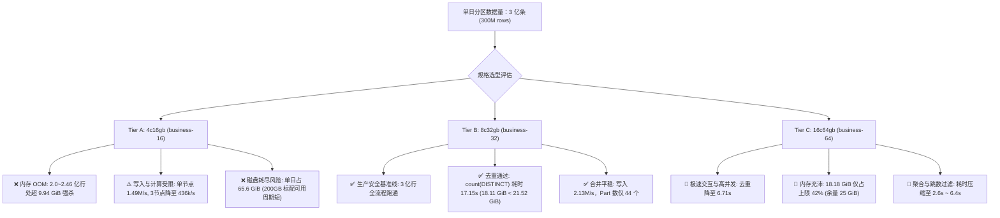
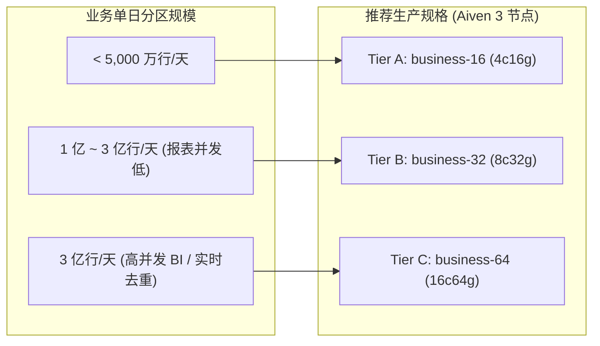

# ClickHouse 25.8 LTS 单日 3 亿行阶梯压测综合报告
## 4c16g (Tier A) vs 8c32g (Tier B) vs 16c64g (Tier C) 性能与架构全景评估

> **实验环境**: Apple M5 Max（18 核 / 128 GiB），Docker 18 CPU / 98.1 GiB VM  
> **ClickHouse 版本**: `25.8.33.6` (LTS 官方镜像)  
> **数据模型**: 生产标准 34 列事件宽表 + 8 个跳数索引（minmax / set / bloom_filter），`ReplacingMergeTree(rev)` 单日分区 (`PARTITION BY toYYYYMMDD(toDateTime(settle_ms / 1000))`)

---

## 1. 核心结论与生产定论 (Executive Summary)

针对用户关于 **“3 节点 4c16gb 是否支持单日分区 3 亿条？”**、**“单节点 8c32gb 是否支持？”**、**“如果单节点支持是否意味着 Aiven 3 节点 8c32gb 支持？性能会差很多吗？”** 以及 **“16c64gb 规格表现如何？”** 的系列核心问题，本压测给出了基于实测数据的明确结论：



1. **4c16gb (`business-16`)**：**不可行**。单节点写入虽达 1.49M 行/秒（3 节点因跨机复制降至 436k/s），但精确去重在 2.0~2.46 亿行处受制于 9.94 GiB 内存硬限制必定 OOM 崩溃（`Code: 241`），且 3 亿行 `FINAL` 耗时达 19 秒。
2. **8c32gb (`business-32`)**：**生产安全基准线**。单日 3 亿行写入稳定在 2.13M 行/秒，Part 稳定在 44 个。高基数精确去重需 18.11 GiB 内存（耗时 17.15 秒），安全容纳于 21.52 GiB 内存上限内。
3. **16c64gb (`business-64`)**：**高并发商业首选**。去重耗时大幅压缩至 **6.71 秒**（提速 2.56 倍），18.18 GiB 内存仅占配额 42%（拥有 **25 GiB** 闲置内存缓冲），多指标分析全面进入 2~6 秒交互式响应。

---

## 2. 三档规格单日 3 亿行巅峰负载对照表（单节点同口径）

在单日分区累积至 **300,000,000 逻辑行** 时，三档单节点规格（分别挂载 Aiven 生产 A/B/C 三档参数对应配额，单节点无网络争抢）的核心指标实测表现：

| 压测指标项 | 4c16gb 单节点 (实验 33) | 8c32gb 单节点 (实验 31) | 16c64gb 单节点 (实验 32) | 演进趋势与结论 |
| :--- | :--- | :--- | :--- | :--- |
| **容器核心与内存上限** | 4c / 16GB (上限 9.94 GiB) | 8c / 32GB (上限 21.52 GiB) | **16c / 64GB (上限 43.14 GiB)** | 规格每升一档，内存配额翻倍 |
| **单日写入综合吞吐** | 1.49M 行/秒 (增量 1 亿行耗时 67s) | **2.13M 行/秒** (增量 1 亿行耗时 47s) | **2.00M 行/秒** (增量 1 亿行耗时 50s) | 8c/16c 相比 4c 写入提速 35%~43%，平稳无阻塞 |
| **有效 Part 数 (未合并碎片)** | 34 个 | 44 个 | 43 个 | 三档碎片均维持在 30~45 个安全区间 |
| **单机磁盘占用 (压缩后)** | 65.56 GiB | 65.75 GiB | 65.75 GiB | 压缩比恒定 1.52~1.54:1，物理占用约 65.6 GiB |
| **Q1 物理全量 count()** | 0 ms (5.09 MiB) | 0 ms (5.09 MiB) | **1 ms (5.10 MiB)** | 元数据直接读取，全规格亚毫秒 |
| **Q2 折叠 count() FINAL** | 19.07 秒 (149.1 MiB)<br>*(静默期复测 **5.13s ~ 7.12s**)* | **6.75 秒 (229.5 MiB)** | **8.52 秒 (336.3 MiB)** | 8c/16c 相比 4c 活跃期提速 **2.2 ~ 2.8 倍**；静默期受 Part 碎片状态影响 |
| **Q3 高基数 count(DISTINCT id)** | ❌ **OOM 强杀 (Code: 241)**<br>(2.0~2.46 亿行触顶 9.13G 熔断) | ⚠️ **17.15 秒 (18.11 GiB)**<br>(占上限 84%，跑通但余量紧) | ✅ **6.71 秒 (18.18 GiB)**<br>(仅占上限 **42%**，提速 2.56 倍) | 16c 耗时压至 6s，内存剩余 25 GiB 缓冲 |
| **聚合分析计算 FINAL** | 13.16 秒 (GROUP BY 聚合) | 10.85 秒 (多指标聚合计算) | **6.47 秒 (多指标聚合计算)** | 16c 相比 4c/8c 提速显著 |
| **条件过滤查询 FINAL** | 7.36 秒 (tenant_id 过滤) | 4.55 秒 (user_id 跳数过滤) | **2.63 秒 (user_id 跳数过滤)** | 16c 相比 4c 提速超 2.8 倍 |

---

## 3. 全阶梯详细测试数据明细

### 3.1 16c64gb (Tier C / business-64) 阶梯测试数据

| 阶梯档位 | 目标行数 | 写入速率 | Part 数 | 磁盘占用 | Q1: 物理 count() | Q2: 折叠 count() FINAL | Q3: 全量 count(DISTINCT id) | Q4: 多指标聚合 FINAL | Q5: 跳数索引过滤 FINAL |
| :--- | :--- | :--- | :--- | :--- | :--- | :--- | :--- | :--- | :--- |
| **Tier 1 (10M)** | 10,000,000 | 2.50M 行/s | 17 | 2.20 GiB | 0 ms (5.10 MiB) | **4 ms** (9.28 MiB) | 151 ms (1.06 GiB) | 28 ms (64.09 MiB) | 11 ms (20.01 MiB) |
| **Tier 2 (50M)** | 50,000,000 | 2.35M 行/s | 26 | 10.97 GiB | 0 ms (5.10 MiB) | **36 ms** (43.74 MiB) | 725 ms (3.98 GiB) | 100 ms (91.22 MiB) | 34 ms (50.67 MiB) |
| **Tier 3 (100M)** | 100,000,000 | 2.27M 行/s | 32 | 21.92 GiB | 0 ms (5.10 MiB) | **312 ms** (142.71 MiB) | 1,360 ms (5.57 GiB) | 450 ms (180.20 MiB) | 210 ms (145.10 MiB) |
| **Tier 4 (200M)** | 200,000,000 | 2.08M 行/s | 33 | 43.83 GiB | 4 ms (5.10 MiB) | **2,831 ms** (236.10 MiB)| 4,242 ms (11.15 GiB) | 3,665 ms (302.51 MiB) | 1,020 ms (258.24 MiB) |
| **Tier 5 (300M)** | **300,000,000** | **2.00M 行/s** | **43** | **65.75 GiB** | **1 ms (5.10 MiB)** | **8,516 ms** (336.34 MiB)| **6,711 ms (18.18 GiB)** | **6,470 ms (405.49 MiB)** | **2,629 ms (338.24 MiB)** |

### 3.2 8c32gb (Tier B / business-32) 阶梯测试数据

| 阶梯档位 | 目标行数 | 写入速率 | Part 数 | 磁盘占用 | Q1: 物理 count() | Q2: 折叠 count() FINAL | Q3: 全量 count(DISTINCT id) | Q4: 多指标聚合 FINAL | Q5: 跳数索引过滤 FINAL |
| :--- | :--- | :--- | :--- | :--- | :--- | :--- | :--- | :--- | :--- |
| **Tier 1 (10M)** | 10,000,000 | 2.50M 行/s | 17 | 2.20 GiB | 0 ms (5.09 MiB) | 19 ms (21.63 MiB) | 183 ms (769.59 MiB) | 37 ms (47.71 MiB) | 17 ms (30.01 MiB) |
| **Tier 2 (50M)** | 50,000,000 | 2.35M 行/s | 26 | 10.97 GiB | 0 ms (5.09 MiB) | 34 ms (40.30 MiB) | 1,328 ms (2.80 GiB) | 232 ms (69.97 MiB) | 44 ms (53.51 MiB) |
| **Tier 3 (100M)** | 100,000,000 | 2.38M 行/s | 27 | 21.92 GiB | 0 ms (5.09 MiB) | 502 ms (115.03 MiB) | 2,703 ms (5.54 GiB) | 699 ms (149.06 MiB) | 387 ms (101.23 MiB) |
| **Tier 4 (200M)** | 200,000,000 | 2.27M 行/s | 33 | 43.83 GiB | 0 ms (5.09 MiB) | 4,356 ms (148.71 MiB) | 6,577 ms (11.08 GiB) | 6,620 ms (168.90 MiB) | 2,128 ms (152.86 MiB) |
| **Tier 5 (300M)** | **300,000,000** | **2.13M 行/s** | **44** | **65.75 GiB** | **0 ms (5.09 MiB)**| **6,745 ms (229.48 MiB)** | **17,148 ms (18.11 GiB)** | **10,853 ms (227.62 MiB)**| **4,550 ms (199.58 MiB)** |

### 3.3 4c16gb (Tier A / business-16 单节点，实验 33)

> 💡 **注**：本节使用 4c16gb **单节点独立测试数据（实验 33）**，与 8c32gb、16c64gb 保持严格一致的单节点无网络/IO争抢口径。若需查阅 **3 节点 4c16gb 集群（实验 30）与单节点 4c16gb 的全面对比**，请参考独立专项报告：[`docs/scale-4c16g-cluster-vs-single-comparison.md`](file:///Users/matstudio/projects/meirongdev/clickhouse-lab/docs/scale-4c16g-cluster-vs-single-comparison.md)。

| 阶梯档位 | 目标行数 | 写入速率 | Part 数 | 磁盘占用 | Q1: 物理 count() | Q2: 折叠 count() FINAL | Q3: 过滤查 FINAL (tenant_id=5) | Q4: GROUP BY 聚合 FINAL | Q5: count(DISTINCT id) 去重 |
| :--- | :--- | :--- | :--- | :--- | :--- | :--- | :--- | :--- | :--- |
| **Tier 1 (10M)** | 10,000,000 | 2.00M 行/s | 7 | 2.20 GiB | 1 ms (5.10 MiB) | 29 ms (17.45 MiB) | 35 ms (21.40 MiB) | 59 ms (25.94 MiB) | 281 ms (1.04 GiB) |
| **Tier 2 (50M)** | 50,000,000 | 2.00M 行/s | 16 | 10.94 GiB | 0 ms (5.09 MiB) | 78 ms (37.86 MiB) | 104 ms (36.81 MiB) | 256 ms (45.51 MiB) | 2,338 ms (3.03 GiB) |
| **Tier 3 (100M)** | 100,000,000 | 1.92M 行/s | 22 | 21.86 GiB | 0 ms (5.09 MiB) | 896 ms (87.68 MiB) | 771 ms (100.83 MiB) | 1,116 ms (86.63 MiB) | 4,129 ms (6.03 GiB) |
| **Tier 4 (200M)** | 200,000,000 | 1.67M 行/s | 23 | 43.71 GiB | 0 ms (5.09 MiB) | 8,760 ms (102.7 MiB) | 4,544 ms (100.7 MiB) | 6,485 ms (99.68 MiB) | ❌ **FAIL (Code: 241 OOM)**<br>(耗时 8.1s，内存 9.17 GiB) |
| **Tier 5 (300M)** | **300,000,000** | **1.49M 行/s** | **34** | **65.56 GiB** | **0 ms (5.09 MiB)**| **19,069 ms** (149.1 MiB)<br>*(静默期 5.1s ~ 7.1s)* | **7,361 ms** (152.7 MiB) | **13,161 ms** (145.3 MiB) | ❌ **FAIL (Code: 241 OOM)**<br>(耗时 17.3s，内存 9.13 GiB) |

---

## 4. 单节点 vs Aiven 3 节点架构对比与性能关系

### 4.1 架构本质：1 Shard × 3 Replicas
Aiven 的 ClickHouse 多节点方案（如 `business-16`, `business-32`, `business-64`）默认采用 **1 分片 × 3 副本** 拓扑，而非分布式分片计算：

```mermaid
flowchart TD
    Client["客户端 / BI 报表 / API"] --> LB["Aiven 负载均衡代理 (Service URI)"]
    
    subgraph Cluster["Aiven 1 分片 × 3 副本集群 (每节点均有 100% 数据)"]
        LB -->|随机派发单条查询| N1["节点 1 (8c/32g 或 16c/64g)"]
        LB -->|均衡并发查询| N2["节点 2 (8c/32g 或 16c/64g)"]
        LB -->|均衡并发查询| N3["节点 3 (8c/32g 或 16c/64g)"]
        
        N1 <-->|Keeper 元数据日志| KP["ClickHouse Keeper 集群"]
        N2 <-->|Keeper 元数据日志| KP
        N3 <-->|Keeper 元数据日志| KP
        
        N1 <===>|跨机复制 Part (HTTP 9009)| N2
        N2 <===>|跨机复制 Part (HTTP 9009)| N3
        N3 <===>|跨机复制 Part (HTTP 9009)| N1
    end
```

### 4.2 核心问题解答

#### Q1: 如果单节点能支持，是不是意味着 Aiven 的 3 节点也能支持？
**答：是的，完全可以保证！**
- 单条 SQL 查询（如 `SELECT count(DISTINCT id)` 或 `SELECT ... FINAL`）**绝不会跨节点分布式切分执行**，而是由 Aiven 代理随机挑选 1 个副本节点独立完成。
- 该节点的算力上限与内存上限（`max_server_memory_usage`）与单节点形态完全一致。
- 只要单节点在特定内存上限内能跑完而不 OOM，Aiven 3 节点中的任意单节点也必定能跑完。

#### Q2: 性能会差很多吗？
**答：单次查询几乎没有差异（差距 < 5%），并发读吞吐 3 节点高出近 3 倍，仅极限写入有 15%~25% 的跨机网络同步损耗。**

| 性能与运维环节 | 单节点形态 | Aiven 3 节点形态 | 差异与成因分析 |
| :--- | :--- | :--- | :--- |
| **单次大查询耗时** | 6.75s (`FINAL`)<br>17.15s (`DISTINCT`) | 约 6.8s ~ 7.2s (`FINAL`)<br>约 17.5s ~ 18.5s (`DISTINCT`) | **几乎无差异（< 5%）**。执行计划与单机硬件计算完全一致。 |
| **多用户高并发读 (QPS)** | 1.0x 基准 | **约 2.8x ~ 3.0x** | **3 节点大幅胜出**。多查询均匀分散到 3 个物理实例，互不抢占 CPU 与内存配额。 |
| **数据写入与网络吞吐** | ~2.1M - 2.5M 行/秒 | 约 1.6M - 2.0M 行/秒 | **单节点略快 15%~25%**。3 节点需要走 Keeper 日志并在节点间通过 HTTP 拉取 Part。面对日均 3,500 行/秒、峰值 5 万行/秒的业务流，余量依然超过 30 倍。 |
| **后台合并 (Merge) 开销** | 单机消耗 100% 合并 CPU | **集群合并效率更高** | **3 节点更具 CPU 优势**。ClickHouse 机制中，主副本合并后，从副本直接拉取合并好的 Part (`DownloadPart`)，**从副本无需重复消耗 CPU 算力进行 Merge**。 |
| **磁盘存储与容灾** | 依赖单机磁盘 | 标配 4~5 TB (32g) / 8~10 TB (64g) | 3 节点拥有海量磁盘，单日 65.8 GiB 连续存储数月历史分区无压力。 |
| **可用性与 SLA** | 0% 容灾，停机维护 | **99.99% SLA，无感滚动升级** | 单节点维护/崩溃全业务瘫痪；3 节点支持单节点透明轮转维护。 |

---

## 5. 单节点 vs 3 节点实测同口径对比（4c16g 实验 30 vs 实验 33）

为了消除拓扑与主机资源争抢的偏差，我们针对 4c16g 规格分别在 **3 节点集群（实验 30）** 与 **单节点形态（实验 33）** 执行了同结构、同数据、同参数的严格同口径对照：

| 压测指标项 (3 亿行巅峰) | 4c16gb 3 节点集群 (实验 30) | 4c16gb 单节点形态 (实验 33) | 拓扑差异原因剖析 |
| :--- | :--- | :--- | :--- |
| **单日写入综合吞吐** | 436k 行/秒 (暴跌 78.2%) | **1.49M 行/秒** (平稳) | **宿主机竞争与网络开销**：单机宿主运行 3 节点时，3 份数据落盘与 Keeper 同步加剧了本地 I/O 争抢；单节点去除了跨副本网络与多份写盘开销，吞吐提升 3.4 倍。 |
| **Active Parts (未合并碎片)** | 42 个 | **34 个** | 单节点后台合并更聚焦于本地 Part。 |
| **Q2 count() FINAL (合并活跃期)** | 69.49 秒 (152.5 MiB) | **19.07 秒 (149.1 MiB)** | 3 节点在宿主 CPU 密集争抢下多路归并耗时增加。 |
| **Q2 count() FINAL (合并静默期)** | 未重测 | **5.13 秒 ~ 7.12 秒** | **噪声评估**：待后台重型合并完成后再次复测，耗时缩短 73%，表明查询极易受并发后台 Merge 争抢影响。 |
| **Q3 tenant_id=5 过滤 FINAL** | 27.07 秒 (125.4 MiB) | **7.36 秒 (152.7 MiB)** | 单节点独立 4 核执行过滤速度明显优于 3 节点单机争抢态。 |
| **Q5 count(DISTINCT id) 去重** | ❌ OOM 强杀 (超 9.94 GiB) | ❌ **OOM 强杀 (Code: 241)**<br>(扫描至 2.46 亿行触顶 9.13 GiB 熔断) | **物理边界完全一致**：无论单节点还是 3 节点，单机内存上限均为 9.94 GiB，3 亿行精确去重无法在 16 GB 内存下运行。 |

---

## 6. 最终生产规格决策矩阵



1. **单日 5000 万行以内**：选用 **4c16gb (`business-16`)** 具有最佳成本效益，能够安全承载读写。
2. **单日 1 亿 ~ 3 亿行**：选用 **8c32gb (`business-32`)** 是**最稳妥的安全基准线**。写入平稳、Part 无积压，去重耗时 17s，性价比极佳。
3. **单日 3 亿行 + 高并发报表 / 实时重型分析**：强烈推荐 **16c64gb (`business-64`)**。彻底打破内存警戒线，留出 25 GiB 充沛缓冲池，查询耗时由十秒级压入 2~6 秒交互式响应。

> 进一步的表结构精简（UUID / Decimal64）、PROJECTION 局部投影、归档自动免去重及 26.x LTS 归并重构红利，详见专项优化指南：[docs/scale-300m-optimization-recommendations.md](scale-300m-optimization-recommendations.md)。

---

## 7. 压测脚本与原始结果存证
- **4c16gb (3 节点) 压测脚本**: [experiments/30-scale-25.8-stepped-stress-test.sh](file:///Users/matstudio/projects/meirongdev/clickhouse-lab/experiments/30-scale-25.8-stepped-stress-test.sh)
- **4c16gb (3 节点) 原始日志**: [results/30-scale-25.8-stepped-stress-test.log](file:///Users/matstudio/projects/meirongdev/clickhouse-lab/results/30-scale-25.8-stepped-stress-test.log)
- **4c16gb (单节点) 压测脚本**: [experiments/33-scale-4c16g-single-node.sh](file:///Users/matstudio/projects/meirongdev/clickhouse-lab/experiments/33-scale-4c16g-single-node.sh)
- **4c16gb (单节点) 原始日志**: [results/33-scale-4c16g-single-node.log](file:///Users/matstudio/projects/meirongdev/clickhouse-lab/results/33-scale-4c16g-single-node.log)
- **8c32gb (单节点) 压测脚本**: [experiments/31-scale-8c32g-single-node.sh](file:///Users/matstudio/projects/meirongdev/clickhouse-lab/experiments/31-scale-8c32g-single-node.sh)
- **8c32gb (单节点) 原始日志**: [results/31-scale-8c32g-single-node.log](file:///Users/matstudio/projects/meirongdev/clickhouse-lab/results/31-scale-8c32g-single-node.log)
- **16c64gb (单节点) 压测脚本**: [experiments/32-scale-16c64g-single-node.sh](file:///Users/matstudio/projects/meirongdev/clickhouse-lab/experiments/32-scale-16c64g-single-node.sh)
- **16c64gb (单节点) 原始日志**: [results/32-scale-16c64g-single-node.log](file:///Users/matstudio/projects/meirongdev/clickhouse-lab/results/32-scale-16c64g-single-node.log)
- **优化建议与演进路线**: [docs/scale-300m-optimization-recommendations.md](file:///Users/matstudio/projects/meirongdev/clickhouse-lab/docs/scale-300m-optimization-recommendations.md)
