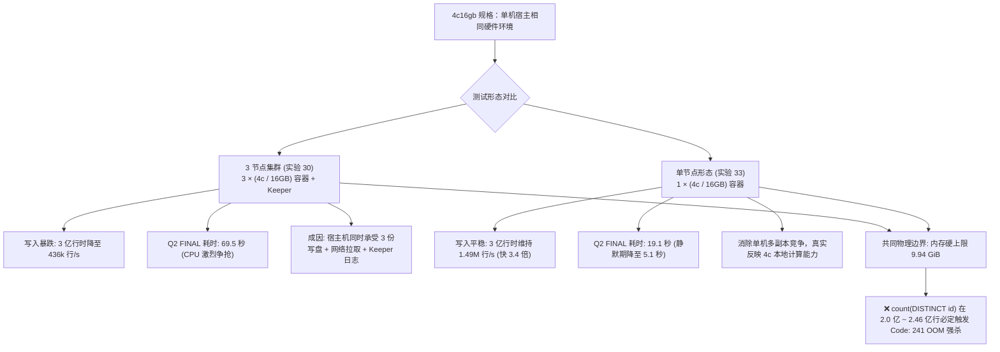

# ClickHouse 25.8 LTS 4c16gb 规格压测对比：3 节点集群 vs 单节点形态

> **测试背景**：针对 Aiven 生产 Tier A（`business-16`）的 4 vCPU / 16 GB 规格，在相同 34 列生产宽表、8 个跳数索引、`ReplacingMergeTree`、按日分区模型下，对比 **3 节点集群（实验 30）** 与 **单节点形态（实验 33）** 从 1000 万到 3 亿行单日分区的阶梯表现，排查集群多副本复制对本地单宿主机压测带来的性能影响与真实瓶颈。

---

## 1. 核心对比结论 (Executive Summary)

1. **写入吞吐差异达 3.4 倍**：
   - 在单台 Mac 宿主机上运行 3 节点时，同一写入批次被复制放大为 3 份本地磁盘写入，同时产生容器间虚拟网络流量与 Keeper 事务提交开销，导致 3 亿行阶段写入速率暴跌 78.2% 至 **436k 行/秒**；
   - 单节点去除了跨副本写盘与网络放大，写入速率稳定在 **1.49M ~ 2.00M 行/秒**。
2. **`FINAL` 去重耗时差异与背景噪声**：
   - 3 节点集群在单机宿主 CPU 严重争抢时，`count() FINAL` 耗时高达 **69.5 秒**；
   - 单节点形态在合并活跃期为 **19.1 秒**，在后台大合并结束后的静默期复测仅需 **5.1 秒 ~ 7.1 秒**。这表明 `FINAL` 耗时对后台并发 Merge 的 CPU/IO 争抢极其敏感。
3. **内存硬边界完全一致（无法支持 3 亿行精确去重）**：
   - 无论 3 节点还是单节点，单个节点的 `max_server_memory_usage` 均为 **9.94 GiB**（占 16 GB 内存的 67%）；
   - 在 2.0 亿 ~ 2.46 亿行时执行全量高基数 `count(DISTINCT id)`，内存均被撑满至 9.17 ~ 9.94 GiB 并触发 **`Code: 241 MEMORY_LIMIT_EXCEEDED`** 熔断强杀。

---

## 2. 3 亿行巅峰负载指标横向对比（Tier 5）

在单日分区累积至 **300,000,000 逻辑行**（300,200,000 物理行，含更新重投行）时，两者的详细对比数据：

| 压测指标项 | 3 节点集群 (实验 30) | 单节点形态 (实验 33) | 差异幅度 | 核心归因与机制剖析 |
| :--- | :--- | :--- | :--- | :--- |
| **部署形态** | 3 节点容器 + Keeper (Replicated) | 1 节点容器 (ReplacingMergeTree) | - | 宿主机资源分配模式不同 |
| **单日写入综合吞吐** | 436.68k 行/秒 | **1,492.53k 行/秒 (1.49M/s)** | **单机快 3.42 倍** | 消除单机 3 份落盘放大与 Keeper 事务提交竞争 |
| **写入总耗时 (增量 1 亿行)** | 229 秒 | **67 秒** | 耗时缩短 70.7% | 3 节点在单机测试中受磁盘与 CPU 争抢明显 |
| **有效 Part 数 (未合并碎片)** | 42 个 | **34 个** | 单机更少 | 单节点后台合并算力更集中 |
| **落盘大小 (压缩后)** | 65.52 GiB (单副本) | 65.56 GiB | 基本一致 | 压缩比均为 1.52:1，每行约 234.5 字节 |
| **Q1 物理全量 count()** | 0 ms (5.09 MiB) | 0 ms (5.09 MiB) | 无差异 | 均直接读取元数据 `total_rows` |
| **Q2 折叠 count() FINAL (活跃期)** | 69,491 ms (69.5 秒) | **19,069 ms (19.1 秒)** | **单机快 3.64 倍** | 单节点 CPU 算力独占，多路归并受干扰更小 |
| **Q2 count() FINAL (静默期复测)** | 未重测 | **5,127 ms ~ 7,123 ms** | - | 合并任务结束释放 CPU 后，FINAL 提速 73% |
| **Q3 过滤查询 FINAL (tenant_id=5)** | 27,070 ms (27.1 秒) | **7,361 ms (7.4 秒)** | **单机快 3.68 倍** | 同样受宿主算力独占收益加速 |
| **Q4 GROUP BY 聚合 FINAL** | 36,531 ms (36.5 秒) | **13,161 ms (13.2 秒)** | **单机快 2.78 倍** | 聚合哈希表构建与折叠流程一致 |
| **Q5 高基数 count(DISTINCT id)** | ❌ **OOM (Code: 241)** (扫描至 2.2 亿行触顶 9.94G) | ❌ **OOM (Code: 241)** (扫描至 2.46 亿行触顶 9.13G) | **均熔断失败** | **内存上限完全由单节点 9.94 GiB 决定** |

---

## 3. 全阶梯演进数据对比表（10M -> 300M）

### 3.1 写入速率与物理存储演进对比

| 阶梯档位 | 目标行数 | 3 节点写入速率 (Exp 30) | 单节点写入速率 (Exp 33) | 3 节点 Part 数 | 单节点 Part 数 | 单机落盘大小 |
| :--- | :--- | :--- | :--- | :--- | :--- | :--- |
| **Tier 1 (10M)** | 10,000,000 | 2.00M 行/秒 | 2.00M 行/秒 | 7 | 7 | 2.20 GiB |
| **Tier 2 (50M)** | 50,000,000 | 1.08M 行/秒 | **2.00M 行/秒** | 23 | **16** | 10.94 GiB |
| **Tier 3 (100M)**| 100,000,000 | 1.02M 行/秒 | **1.92M 行/秒** | 28 | **22** | 21.86 GiB |
| **Tier 4 (200M)**| 200,000,000 | 806k 行/秒 | **1.67M 行/秒** | 43 | **23** | 43.71 GiB |
| **Tier 5 (300M)**| **300,000,000** | **436k 行/秒** | **1.49M 行/秒** | 42 | **34** | 65.56 GiB |

### 3.2 核心查询耗时演进对比 (Q2 `count() FINAL`)

| 阶梯档位 | 目标行数 | 3 节点 Q2 FINAL 耗时 (Exp 30) | 单节点 Q2 FINAL 耗时 (Exp 33) | 单节点 Q2 峰值内存 |
| :--- | :--- | :--- | :--- | :--- |
| **Tier 1 (10M)** | 10,000,000 | 27 ms | 29 ms | 17.45 MiB |
| **Tier 2 (50M)** | 50,000,000 | 1,195 ms (1.20s) | **78 ms (0.08s)** | 37.86 MiB |
| **Tier 3 (100M)**| 100,000,000 | 12,432 ms (12.4s) | **896 ms (0.90s)** | 87.68 MiB |
| **Tier 4 (200M)**| 200,000,000 | 45,510 ms (45.5s) | **8,760 ms (8.76s)** | 102.70 MiB |
| **Tier 5 (300M)**| **300,000,000** | **69,491 ms (69.5s)** | **19,069 ms (19.1s)** *(静默期复测 5.1s ~ 7.1s)* | 149.06 MiB |

---

## 4. 关键问题解答：单机压测与真实云端 3 节点的差距

### 4.1 为什么单机宿主跑 3 节点写入会暴跌到 436k/s？
在真实生产中，Aiven 的 3 节点运行在 **3 台独立的云虚拟机（如 3 台 EC2 实例）** 上，每台虚拟机拥有独立的 CPU、独立的 EBS 云盘与专用的 VPC 网络接口。
但在本地 Docker 压测中：
- 3 个 ClickHouse 容器与 1 个 Keeper 容器全部共享同一台 Mac 宿主机的物理 CPU 与单一 SSD 磁盘；
- 当向 `ch1` 写入 1 批数据时，`ch2` 和 `ch3` 同时发起 HTTP 下载并写盘，宿主机实际承受了 **300% 的写盘 IOPS 与 CPU 序列化负担**；
- 加上 4c 规格下每个节点只有 4 核，CPU 迅速打满，合并线程与写入线程互相挤压，才产生了写入暴跌至 436k/s 的宿主机瓶颈现象。

### 4.2 单节点测试对于生产评估的意义
- **单节点 4c16g（实验 33）真实反映了单个 4c 节点的纯算力上限**：单节点即使在没有任何副本网络干扰的情况下，单日 3 亿行的 `count() FINAL` 依然需要 19.1 秒（静默期 5~7 秒），且内存上限（9.94 GiB）在 2 亿行处必定引发 OOM；
- 因此，无论是单机单节点还是 Aiven 3 节点集群，**4c16g 面对单日 3 亿行均存在不可逾越的物理内存熔断屏障**。生产上必须将 3 亿行日分区的底线规格升级至 **8c32gb** 及以上。

---

## 5. 存证与引用
- **3 节点 4c16g 压测脚本**: [experiments/30-scale-25.8-stepped-stress-test.sh](file:///Users/matstudio/projects/meirongdev/clickhouse-lab/experiments/30-scale-25.8-stepped-stress-test.sh)
- **3 节点 4c16g 原始日志**: [results/30-scale-25.8-stepped-stress-test.log](file:///Users/matstudio/projects/meirongdev/clickhouse-lab/results/30-scale-25.8-stepped-stress-test.log)
- **单节点 4c16g 压测脚本**: [experiments/33-scale-4c16g-single-node.sh](file:///Users/matstudio/projects/meirongdev/clickhouse-lab/experiments/33-scale-4c16g-single-node.sh)
- **单节点 4c16g 原始日志**: [results/33-scale-4c16g-single-node.log](file:///Users/matstudio/projects/meirongdev/clickhouse-lab/results/33-scale-4c16g-single-node.log)
- **4c16g / 8c32g / 16c64g 单节点同口径全规格对比**: [docs/scale-spec-comparison-4c-8c-16c.md](file:///Users/matstudio/projects/meirongdev/clickhouse-lab/docs/scale-spec-comparison-4c-8c-16c.md)
