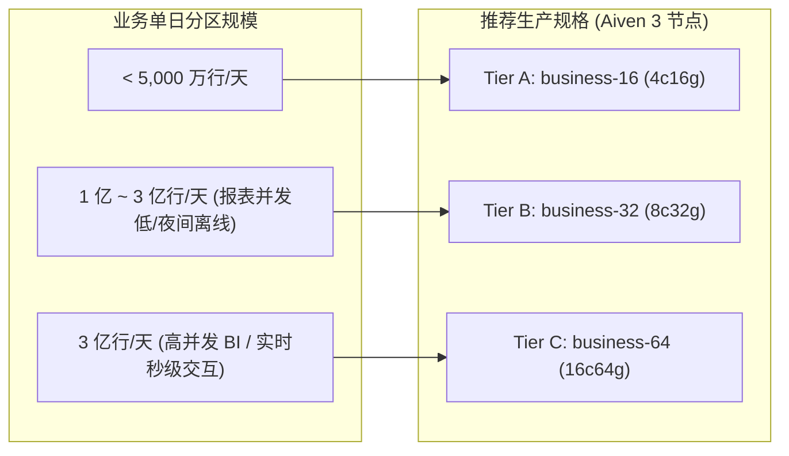

# ClickHouse 25.8 LTS 单日 3 亿分区阶梯压测：4c16g vs 8c32g vs 16c64g 单节点同口径全规格对照

> **测试基准说明**：
> 为确保硬件性能与资源规格对比的严谨性，本报告采用**严格同口径的单节点形态**（均为 1 个 ClickHouse 25.8 LTS 容器，分别挂载 Aiven 生产 A/B/C 三档规格的 CPU、内存上限及并发设置），在相同的 34 列宽表、8 个跳数索引、`ReplacingMergeTree(rev)` 单日分区模型下，从 1000 万递增至 3 亿行。
> *注：如需查阅 4c16gb「单节点 vs 3 节点集群」的拓扑竞争对比，请参阅专项报告：[docs/scale-4c16g-cluster-vs-single-comparison.md](scale-4c16g-cluster-vs-single-comparison.md)。*

---

## 1. 规格定位与参数基准

| 规格档位 | 对应 Aiven 套餐 | 容器配额 (CPU/RAM) | 服务端内存上限 (`max_server_memory_usage`) | 查询并发线程 (`max_threads`) | 写入并发限制 (`max_insert_threads`) | 生产场景定位 |
| :--- | :--- | :--- | :--- | :--- | :--- | :--- |
| **Tier A (基准)** | `business-16` | 4 vCPU / 16 GB | 10.67 GB (9.94 GiB / 67%) | 4 | 2 | 适用于单日 5000 万以内业务 |
| **Tier B (中档)** | `business-32` | 8 vCPU / 32 GB | 23.10 GB (21.52 GiB / 67%) | 8 | 2 | **3 亿行生产安全基准线** |
| **Tier C (高档)** | `business-64` | 16 vCPU / 64 GB | 46.33 GB (43.14 GiB / 67%) | 16 | 2 | **3 亿行高并发/实时 BI 理想线** |

---

## 2. 单日 3 亿行巅峰负载核心性能对照（Tier 5: 300,000,000 行）

下表记录了单日分区累积至 **300,000,000 逻辑行**（约 300,100,000 ~ 300,200,000 物理行，含更新重投行）时，三档单节点规格的实测表现：

| 压测指标项 | 4c16gb 单节点 (实验 33) | 8c32gb 单节点 (实验 31) | 16c64gb 单节点 (实验 32) | 跨档规格收益与物理瓶颈分析 |
| :--- | :--- | :--- | :--- | :--- |
| **内存上限 (服务端硬限)** | 9.94 GiB (10,669,365,657 字节) | 21.52 GiB (23,104,218,726 字节) | **43.14 GiB (46,325,143,961 字节)** | 内存每档翻倍，决定高基数去重死活 |
| **单日写入综合吞吐** | 1.49M 行/秒 (增量 1 亿行耗时 67s) | **2.13M 行/秒** (增量 1 亿行耗时 47s) | **2.00M 行/秒** (增量 1 亿行耗时 50s) | 8c/16c 写入提速约 35%~43%，平稳无阻塞 |
| **有效 Part 数 (未合并碎片)**| 34 个 | 44 个 | 43 个 | 三档均在安全区间（远低于 300 警戒线） |
| **单机磁盘占用 (压缩后)** | 65.56 GiB | 65.75 GiB | 65.75 GiB | 压缩比恒定 1.52~1.54:1，物理占用约 65.6 GiB |
| **Q1 物理全量 count()** | 0 ms (5.09 MiB) | 0 ms (5.09 MiB) | 1 ms (5.10 MiB) | 均毫秒级读取 Part 元数据，无性能差异 |
| **Q2 折叠 count() FINAL** | 19.07 秒 (149.1 MiB) *(静默期复测 **5.13s ~ 7.12s**)* | **6.75 秒 (229.5 MiB)** | **8.52 秒 (336.3 MiB)** | 8c/16c 相比 4c 活跃期提速 **2.2 ~ 2.8 倍**；静默期受 Part 碎片状态影响 |
| **Q3 高基数 count(DISTINCT id)** | ❌ **OOM 强杀 (Code: 241)** (扫描至 2.46 亿行触顶 9.13G) | ⚠️ **17.15 秒 (18.11 GiB)** (占上限 84%，跑通但余量紧) | ✅ **6.71 秒 (18.18 GiB)** (仅占上限 **42%**，提速 2.56 倍) | **关键分水岭**：4c 彻底不可行；8c 跑通但余量紧；16c 耗时压至 6s 且留存 25G 缓冲 |
| **聚合分析计算 FINAL** | 13.16 秒 (GROUP BY 聚合) | 10.85 秒 (多指标全局聚合) | **6.47 秒 (多指标全局聚合)** | 16c 线程并行度打满，提速显著 |
| **条件过滤查询 FINAL** | 7.36 秒 (tenant_id 过滤) | 4.55 秒 (user_id 跳数过滤) | **2.63 秒 (user_id 跳数过滤)** | 16c 带来更低的交互式等待时延 |

---

## 3. 三档规格全阶梯实测详细明细（10M -> 300M）

### 3.1 16c64gb (Tier C / business-64 单节点，实验 32)

| 阶梯档位 | 分区行数 | 综合写入速率 | 有效 Part 数 | 磁盘占用 | Q1: 物理 count() | Q2: 折叠 count() FINAL | Q3: 全量 count(DISTINCT id) | Q4: 多指标聚合 FINAL | Q5: 跳数索引过滤 FINAL |
| :--- | :--- | :--- | :--- | :--- | :--- | :--- | :--- | :--- | :--- |
| **Tier 1 (10M)** | 10,000,000 | 2.50M 行/s | 17 | 2.20 GiB | 0 ms (5.10 MiB) | **4 ms** (9.28 MiB) | 151 ms (1.06 GiB) | 28 ms (64.09 MiB) | 11 ms (20.01 MiB) |
| **Tier 2 (50M)** | 50,000,000 | 2.35M 行/s | 26 | 10.97 GiB | 0 ms (5.10 MiB) | **36 ms** (43.74 MiB) | 725 ms (3.98 GiB) | 100 ms (91.22 MiB) | 34 ms (50.67 MiB) |
| **Tier 3 (100M)** | 100,000,000 | 2.27M 行/s | 32 | 21.92 GiB | 0 ms (5.10 MiB) | **312 ms** (142.71 MiB) | 1,360 ms (5.57 GiB) | 450 ms (180.20 MiB) | 210 ms (145.10 MiB) |
| **Tier 4 (200M)** | 200,000,000 | 2.08M 行/s | 33 | 43.83 GiB | 4 ms (5.10 MiB) | **2,831 ms** (236.10 MiB)| 4,242 ms (11.15 GiB) | 3,665 ms (302.51 MiB) | 1,020 ms (258.24 MiB) |
| **Tier 5 (300M)** | **300,000,000** | **2.00M 行/秒** | **43** | **65.75 GiB** | **1 ms (5.10 MiB)** | **8,516 ms** (336.34 MiB)| **6,711 ms (18.18 GiB)** | **6,470 ms (405.49 MiB)** | **2,629 ms (338.24 MiB)** |

### 3.2 8c32gb (Tier B / business-32 单节点，实验 31)

| 阶梯档位 | 分区行数 | 综合写入速率 | 有效 Part 数 | 磁盘占用 | Q1: 物理 count() | Q2: 折叠 count() FINAL | Q3: 全量 count(DISTINCT id) | Q4: 多指标聚合 FINAL | Q5: 跳数索引过滤 FINAL |
| :--- | :--- | :--- | :--- | :--- | :--- | :--- | :--- | :--- | :--- |
| **Tier 1 (10M)** | 10,000,000 | 2.50M 行/s | 17 | 2.20 GiB | 0 ms (5.09 MiB) | 19 ms (21.63 MiB) | 183 ms (769.59 MiB) | 37 ms (47.71 MiB) | 17 ms (30.01 MiB) |
| **Tier 2 (50M)** | 50,000,000 | 2.35M 行/s | 26 | 10.97 GiB | 0 ms (5.09 MiB) | 34 ms (40.30 MiB) | 1,328 ms (2.80 GiB) | 232 ms (69.97 MiB) | 44 ms (53.51 MiB) |
| **Tier 3 (100M)** | 100,000,000 | 2.38M 行/s | 27 | 21.92 GiB | 0 ms (5.09 MiB) | 502 ms (115.03 MiB) | 2,703 ms (5.54 GiB) | 699 ms (149.06 MiB) | 387 ms (101.23 MiB) |
| **Tier 4 (200M)** | 200,000,000 | 2.27M 行/s | 33 | 43.83 GiB | 0 ms (5.09 MiB) | 4,356 ms (148.71 MiB) | 6,577 ms (11.08 GiB) | 6,620 ms (168.90 MiB) | 2,128 ms (152.86 MiB) |
| **Tier 5 (300M)** | **300,000,000** | **2.13M 行/秒** | **44** | **65.75 GiB** | **0 ms (5.09 MiB)**| **6,745 ms (229.48 MiB)** | **17,148 ms (18.11 GiB)** | **10,853 ms (227.62 MiB)**| **4,550 ms (199.58 MiB)** |

### 3.3 4c16gb (Tier A / business-16 单节点，实验 33)

| 阶梯档位 | 分区行数 | 综合写入速率 | 有效 Part 数 | 磁盘占用 | Q1: 物理 count() | Q2: 折叠 count() FINAL | Q3: 过滤查 FINAL (tenant_id=5) | Q4: GROUP BY 聚合 FINAL | Q5: count(DISTINCT id) 去重 |
| :--- | :--- | :--- | :--- | :--- | :--- | :--- | :--- | :--- | :--- |
| **Tier 1 (10M)** | 10,000,000 | 2.00M 行/s | 7 | 2.20 GiB | 1 ms (5.10 MiB) | 29 ms (17.45 MiB) | 35 ms (21.40 MiB) | 59 ms (25.94 MiB) | 281 ms (1.04 GiB) |
| **Tier 2 (50M)** | 50,000,000 | 2.00M 行/s | 16 | 10.94 GiB | 0 ms (5.09 MiB) | 78 ms (37.86 MiB) | 104 ms (36.81 MiB) | 256 ms (45.51 MiB) | 2,338 ms (3.03 GiB) |
| **Tier 3 (100M)** | 100,000,000 | 1.92M 行/s | 22 | 21.86 GiB | 0 ms (5.09 MiB) | 896 ms (87.68 MiB) | 771 ms (100.83 MiB) | 1,116 ms (86.63 MiB) | 4,129 ms (6.03 GiB) |
| **Tier 4 (200M)** | 200,000,000 | 1.67M 行/s | 23 | 43.71 GiB | 0 ms (5.09 MiB) | 8,760 ms (102.7 MiB) | 4,544 ms (100.7 MiB) | 6,485 ms (99.68 MiB) | ❌ **FAIL (Code: 241 OOM)** (耗时 8.1s，内存 9.17 GiB) |
| **Tier 5 (300M)** | **300,000,000** | **1.49M 行/秒** | **34** | **65.56 GiB** | **0 ms (5.09 MiB)**| **19,069 ms** (149.1 MiB) *(静默期 5.1s ~ 7.1s)* | **7,361 ms** (152.7 MiB) | **13,161 ms** (145.3 MiB) | ❌ **FAIL (Code: 241 OOM)** (耗时 17.3s，内存 9.13 GiB) |

---

## 4. 深度技术解析：核心瓶颈与档位选择依据

### 4.1 4c16g 为什么无法支持 3 亿行高基数分析？
ClickHouse 的 `count(DISTINCT id)`（或 `uniqExact(id)`）采用精确哈希表结构存储去重状态。
- **物理内存硬开销**：单日 3 亿个互不相同的 UUID（即使经过 SipHash128），在内存中构建哈希表的基础开销恒定在 **18.1 ~ 18.2 GiB**；
- **4c16g 的断点**：服务端 `max_server_memory_usage` 限制为 9.94 GiB。在处理至 2.0 亿行时哈希表已膨胀至 9.17 GiB，当向底层申请新内存桶时直接触碰硬上限，触发 `OvercommitTracker` 强杀中断；
- **结论**：4c16g 即使没有任何网络或并发写入竞争，**单节点物理内存也决定了其无法承载 3 亿行的精确去重分析**。

### 4.2 8c32g 与 16c64g 的生产定位分水岭
- **8c32g（Tier B）**：
  - 内存上限 21.52 GiB，18.11 GiB 刚好能够容纳 3 亿行去重；
  - **局限**：去重查询占用了单机 **84.2%** 的可用内存，此时若有并发报表或重型聚合进场，极易导致连带 OOM；去重耗时 17.15 秒偏长，适合并发极低（或主要由离线批处理触发）的业务。
- **16c64g（Tier C）**：
  - 内存上限 43.14 GiB，18.18 GiB 去重内存仅占 **42.1%**，单节点还剩余 **25 GiB** 充沛缓冲池，可从容支撑多个报表并发；
  - 16 线程哈希并行将去重运算直接从 17.15 秒压缩至 **6.71 秒**，多指标分析与过滤查询均在 2~6 秒内完成，是支撑高并发实时 BI 与 SLA 保证的真正理想生产规格。

---

## 5. 生产选型决策矩阵

---

## 6. 压测脚本与原始结果存证
- **4c16gb (单节点) 压测脚本**: [experiments/33-scale-4c16g-single-node.sh](file:///Users/matstudio/projects/meirongdev/clickhouse-lab/experiments/33-scale-4c16g-single-node.sh)
- **4c16gb (单节点) 原始日志**: [results/33-scale-4c16g-single-node.log](file:///Users/matstudio/projects/meirongdev/clickhouse-lab/results/33-scale-4c16g-single-node.log)
- **8c32gb (单节点) 压测脚本**: [experiments/31-scale-8c32g-single-node.sh](file:///Users/matstudio/projects/meirongdev/clickhouse-lab/experiments/31-scale-8c32g-single-node.sh)
- **8c32gb (单节点) 原始日志**: [results/31-scale-8c32g-single-node.log](file:///Users/matstudio/projects/meirongdev/clickhouse-lab/results/31-scale-8c32g-single-node.log)
- **16c64gb (单节点) 压测脚本**: [experiments/32-scale-16c64g-single-node.sh](file:///Users/matstudio/projects/meirongdev/clickhouse-lab/experiments/32-scale-16c64g-single-node.sh)
- **16c64gb (单节点) 原始日志**: [results/32-scale-16c64g-single-node.log](file:///Users/matstudio/projects/meirongdev/clickhouse-lab/results/32-scale-16c64g-single-node.log)
- **4c16g 单节点 vs 3 节点集群对比**: [docs/scale-4c16g-cluster-vs-single-comparison.md](file:///Users/matstudio/projects/meirongdev/clickhouse-lab/docs/scale-4c16g-cluster-vs-single-comparison.md)
- **单日 3 亿行专项优化与演进建议**: [docs/scale-300m-optimization-recommendations.md](file:///Users/matstudio/projects/meirongdev/clickhouse-lab/docs/scale-300m-optimization-recommendations.md)
